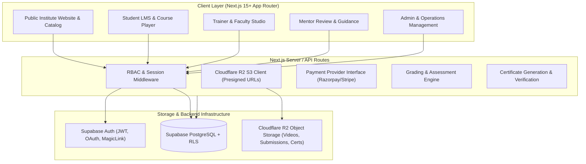

# TEJAS Institute of Advanced Technology
## Architectural Blueprint & System Specifications

### Executive Overview
**TEJAS** (*Institute of Advanced Technology*) is a next-generation engineering academy headquartered in **Bhubaneswar, Odisha, India**.
- **Tagline**: Building India’s Next-Generation Technologists
- **Core USP**: LEARN WHILE YOU WORK
- **7-Stage Learning Philosophy**: Learn → Lab → Apply → Mentor Review → Improve → Document → Demonstrate
- **Aesthetic Benchmark**: High-performance SaaS platform + GitHub / Linear precision + modern engineering institute.

---

## 1. System Architecture



---

## 2. Route & Page Map

### A. Public Website
- `/` - Premium Hero, Tech Visualizations, 7-Stage Philosophy, 5 Schools Showcase, Featured Projects, Industry Partners, Testimonials, Bhubaneswar Campus.
- `/about` - Overview of TEJAS institute, leadership, Bhubaneswar campus, culture.
- `/about/vision` - The vision for India's technological self-reliance & deep-tech talent pipeline.
- `/about/faculty` - Distinguished faculty, industry leaders, and research directors.
- `/about/labs` - Advanced computing, GPU clusters, robotics, semiconductor & clean-energy lab facilities.
- `/about/career-support` - Corporate hiring partners, incubation, placement metrics, career pathways.
- `/programs` - Filterable catalog of all 17 programs across 5 schools.
- `/programs/[slug]` - Deep-dive curriculum, 36-class structure, tools, labs, projects, mentors, FAQs, CTA.
- `/schools` & `/schools/[slug]` - The 5 foundational schools of advanced technology.
- `/learn-while-you-work` - In-depth breakdown of the 7-step pedagogical flywheel.
- `/projects` - Showcase of student & lab projects built at TEJAS with demo links & GitHub repos.
- `/career` - Careers at TEJAS (faculty, lab mentors, curriculum engineers).
- `/admissions` & `/admissions/apply` - Multi-step interactive student admissions application form.
- `/blog` & `/contact` & `/faq` - Insights, inquiry forms, campus visit directions.
- `/verify/[certificateId]` - Public tamper-proof certificate verification page with cryptographic checksums.

### B. Authenticated Dashboards
- `/dashboard` - Unified role-based redirection gateway.
- `/dashboard/student` - Full student LMS portal (Continue learning, modules, attendance, assignments, assessments, project tracker, mentor feedback, digital portfolio, certificates).
- `/dashboard/student/courses/[courseId]/learn/[lessonId]` - 3-Pane Course Player (Navigation, Video/Markdown, Notes/Resources/Mentor Q&A).
- `/dashboard/trainer` - Curriculum authoring studio, batch management, attendance marking, assignment grading, assessment bank.
- `/dashboard/mentor` - Project review boards, 1-on-1 scheduling, code review diffs, approval workflows.
- `/dashboard/admin` - Executive metrics, user role management (RBAC), program lifecycle, financial/batch analytics, audit logs.

---

## 3. Database Schema Plan (PostgreSQL / Supabase)

### Core Enums & Tables
1. **Enums**:
   - `user_role`: `SUPER_ADMIN`, `ADMIN`, `ACADEMIC_ADMIN`, `TRAINER`, `MENTOR`, `STUDENT`, `COUNSELLOR`, `CONTENT_MANAGER`, `FINANCE`
   - `content_status`: `DRAFT`, `REVIEW`, `PUBLISHED`, `ARCHIVED`
   - `submission_status`: `SUBMITTED`, `UNDER_REVIEW`, `CHANGES_REQUESTED`, `RESUBMITTED`, `APPROVED`
   - `project_status`: `IDEA`, `PLANNING`, `BUILDING`, `REVIEW`, `IMPROVEMENT`, `COMPLETED`, `DEMONSTRATED`
   - `attendance_status`: `PRESENT`, `ABSENT`, `LATE`, `EXCUSED`
   - `application_status`: `NEW`, `CONTACTED`, `COUNSELLING`, `SHORTLISTED`, `ENROLLED`, `REJECTED`, `WITHDRAWN`

2. **Core Entities**:
   - `profiles`: id, full_name, email, role, avatar_url, phone, bio, github_url, linkedin_url, portfolio_url, location, is_public.
   - `schools`: id, name, slug, description, icon, order_idx.
   - `programs`: id, school_id, title, slug, description, duration, class_count, badge, curriculum, prerequisites, career_outcomes, tools, fee_inr.
   - `courses`: id, program_id, title, slug, description, order_idx, status.
   - `modules`: id, course_id, title, description, order_idx.
   - `lessons`: id, module_id, title, slug, lesson_type (video/reading/interactive), duration_mins, video_url, r2_key, content_markdown, is_free_preview.
   - `lesson_progress`: id, student_id, lesson_id, watched_seconds, total_seconds, is_completed, last_accessed_at.
   - `batches`: id, program_id, name, start_date, end_date, trainer_id, mentor_id, max_capacity, status.
   - `enrollments`: id, student_id, program_id, batch_id, enrolled_at, status, progress_pct.
   - `attendance`: id, batch_id, student_id, session_date, session_topic, status, remarks.
   - `assignments`: id, module_id, title, description, max_score, due_date, r2_attachment_key.
   - `assignment_submissions`: id, assignment_id, student_id, submission_text, github_url, live_url, r2_file_key, status, score, feedback, reviewer_id.
   - `assessments`: id, module_id, title, description, time_limit_mins, pass_percentage, total_questions.
   - `assessment_questions`: id, assessment_id, question_text, question_type (mcq/coding/descriptive), options_json, correct_answer, points.
   - `assessment_attempts`: id, assessment_id, student_id, score, percentage, passed, submitted_at, answers_json.
   - `projects`: id, program_id, student_id, mentor_id, title, description, tech_stack, github_url, demo_url, status, score, mentor_review.
   - `certificates`: id, certificate_id (UUID/TEJAS-2026-XXXX), student_id, program_id, issued_at, grade, verification_hash, r2_pdf_key.
   - `applications`: id, full_name, email, phone, program_id, education, experience, city, career_goal, status, notes.
   - `audit_logs`: id, actor_id, action, resource_type, resource_id, metadata, ip_address, created_at.

---

## 4. Cloudflare R2 Storage Design
S3-Compatible Object Storage hierarchy:
```
tejas-storage/
├── courses/{course_id}/materials/{filename}
├── videos/{course_id}/{lesson_id}/master.mp4
├── assignments/{assignment_id}/{student_id}/{timestamp}_{filename}
├── projects/{project_id}/documents/{filename}
├── certificates/{certificate_id}.pdf
└── avatars/{user_id}.jpg
```
- **Security**: Never expose R2 secret credentials in client-side bundles.
- **Access Pattern**: Next.js Server Actions / API routes issue time-limited AWS Presigned URLs (GET for streaming/viewing, PUT for uploads).

---

## 5. Technology Stack Decisions
- **Framework**: Next.js 15 (App Router) + React 19 + TypeScript.
- **Styling**: Tailwind CSS + Radix UI primitives + Lucide React icons + Class Variance Authority.
- **Animation**: Framer Motion for high-impact hero metrics, 7-step flywheel, and tab transitions.
- **Data Visualization**: Recharts for student performance, attendance breakdown, and admin platform analytics.
- **Forms & Validation**: React Hook Form + Zod schema validation.
- **Storage**: `@aws-sdk/client-s3` + `@aws-sdk/s3-request-presigner` for Cloudflare R2.
- **Database/Auth**: `@supabase/supabase-js` + `@supabase/ssr` with client-safe mock fallback for instant zero-config demonstration.
