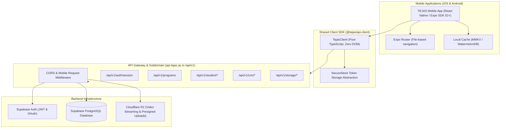

# TEJAS Mobile Application Architecture Blueprint
## React Native (Expo) & Cross-Platform Mobile Strategy

This document specifies the technical architecture for the **TEJAS Institute mobile applications** (iOS & Android), enabling fellows, faculty, and counselors to experience the platform natively while sharing business logic and contracts with the core Next.js web application.

---

## 1. High-Level Architecture



---

## 2. Directory Layout for Future Mobile App (`apps/mobile`)

When initiating the Expo / React Native codebase:

```
tejas-mobile/
├── app/                          # Expo Router file-based navigation
│   ├── (auth)/
│   │   ├── signin.tsx            # Supabase email/password & OTP signin
│   │   └── signup.tsx
│   ├── (tabs)/
│   │   ├── _layout.tsx           # Tab Bar (Learn, Labs, Projects, Profile)
│   │   ├── index.tsx             # Student Dashboard / Progress Flywheel
│   │   ├── courses/
│   │   │   ├── [courseId].tsx    # Syllabus & 36 Master Classes
│   │   │   └── player/[lessonId].tsx # Video Player + Notes
│   │   ├── labs.tsx              # Scheduled Bhubaneswar hardware labs
│   │   ├── projects.tsx          # Fellow Capstone Submission & GitHub PR review
│   │   └── profile.tsx           # Digital Credential & Mentor Feedback
│   └── _layout.tsx               # Root Navigation, Theme, and Auth Guard
├── components/
│   ├── ui/                       # Native paper / card components
│   ├── video-player.tsx          # expo-video / expo-av with HLS streaming
│   └── code-viewer.tsx           # Monospace AST / syntax viewer
├── lib/
│   ├── api.ts                    # Exports configured TejasClient instance
│   ├── auth.ts                   # SecureStore integration for Supabase JWT
│   └── push.ts                   # Expo Notifications & Push tokens
├── app.json                      # Expo configuration & Bundle IDs
└── package.json
```

---

## 3. Platform-Agnostic SDK Integration

The core repository already includes the pure TypeScript client at `lib/api-client/index.ts`. In the mobile app:

```typescript
import * as SecureStore from 'expo-secure-store';
import { TejasClient } from '@tejas/api-client';

export const mobileApi = new TejasClient({
  baseUrl: 'https://api.tejas.bhashaai.in', // or https://api.tejas.ac.in
  platform: 'expo',
  clientVersion: '1.0.0',
  getAuthToken: async () => {
    return await SecureStore.getItemAsync('tejas_jwt_token');
  },
  onUnauthorized: () => {
    // Navigate to mobile login screen
  },
});
```

---

## 4. Mobile Video Streaming & Cloudflare R2

Mobile streaming for the 36 master classes:
1. Mobile app requests `/api/v1/student/lessons/:id`.
2. Backend generates a signed Cloudflare R2 presigned streaming URL (`expiresIn: 3600`).
3. Mobile app renders video using `expo-video` with hardware decoding and playback speed controls (`1x`, `1.25x`, `1.5x`, `2x`).
4. Playback position periodically reports to `/api/v1/student/progress` to resume seamlessly across desktop and mobile.

---

## 5. Offline Capability & Local Caching
- **State & Network**: `@tanstack/react-query` with `createAsyncStoragePersister` or `react-native-mmkv` for sub-millisecond local caching of curricula, notes, and attendance.
- **Offline Submissions**: Fellows can draft code review notes and submission metadata offline; syncs automatically once connectivity returns.

---

## 6. Push Notifications (Expo Push / FCM)
- **Use Cases**:
  - Weekly mentor code review completed / changes requested.
  - Hardware GPU cluster batch reservation ready (e.g., *H100 node available*).
  - Admissions interview slot reminder for shortlisted candidates.
- **Token Registration**: Mobile app registers push token on sign-in via `/api/v1/notifications/register-token`.
