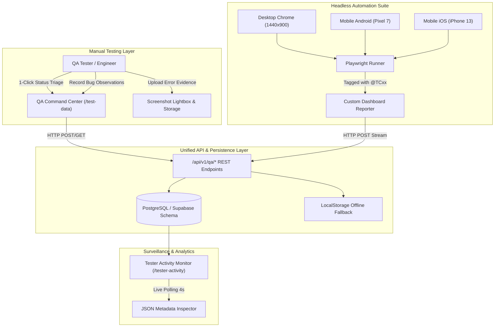

# TEJAS Unified In-App QA & Automation Testing Framework

> **Enterprise Quality Assurance & Multi-Device Automated Test Engineering Blueprint**  
> *Principal QA Architect & Lead System Engineers — TEJAS Institute*

---

## 1. Executive Summary & Architectural Overview

The **TEJAS Unified In-App QA & Automation Testing Framework** bridges the historical gap between manual QA testers and headless CI/CD test automation pipelines. Manual exploratory testing, bug observations, and screenshot evidence live side-by-side with multi-device automated test runs (Desktop Chrome, Android Pixel 7, and iOS iPhone 13) in a unified database schema and responsive web application.



---

## 2. The 5 Core Architectural Pillars

### Pillar 1: Database Schema & Storage
The foundation consists of 3 production-grade tables with Row Level Security (RLS) and 8 performance composite indexes:

1. **`qa_test_cases`**:
   - `id`: UUID (Primary Key)
   - `test_id`: Canonical unique identifier (`TC01` to `TC20`)
   - `title`, `category`, `module`, `description`
   - `steps`: Structured JSONB array containing ordered reproduction instructions
   - `expected_result`: Green-highlighted acceptance criteria
   - `priority`: `Critical` | `High` | `Medium` | `Low`
   - `is_automated`: Boolean indicator
   - `automated_tag`: Canonical Playwright grep tag (e.g., `@TC01`)
   - `target_url`: Direct deep-link to test target route

2. **`qa_test_results`**:
   - Stores day-wise test execution outcomes (`passed`, `failed`, `retest`, `blocked`, `pending`)
   - `cycle_date`: Tracks daily regression cycles (e.g., `2026-10-04`)
   - `observations`: Markdown/plain text bug reproduction notes
   - `screenshot_url`: Direct URL or base64 data-URL of visual evidence
   - `run_mode`: `manual` vs `automated`
   - `device_info`: Browser, viewport, and OS telemetry
   - `duration_ms`: Execution speed in milliseconds
   - `error_message`: Stack trace or assertion failure summary

3. **`qa_tester_activity_logs`**:
   - Real-time audit log of tester actions (`login`, `page_view`, `test_execute`, `observation_save`, `screenshot_upload`, `suite_trigger`)
   - `metadata`: Flexible JSONB payload storing route visited, device user-agent, error objects, and duration

4. **Storage Bucket `qa-evidence`**:
   - Dedicated bucket with 10MB file limit for PNG/JPEG screenshot evidence uploads

---

### Pillar 2: In-App QA Command Center (`/test-data`)

The primary workspace for manual testers and QA Leads, accessible at `/test-data`:

- **Summary Metric Cards**: Live counters for Total Tests, Passed %, Failed %, Pending Retests, and Blocked cases.
- **Cycle Date Picker**: Day-wise selector allowing testers to view historical cycles or execute the current day's cycle with a 1-click **Today** shortcut.
- **Tab 1: Test Cases & Execution**:
  - Filter by Module (15 distinct subsystems), Priority (Critical, High, Medium, Low), and Status (Passed, Failed, Retest, Blocked, Pending).
  - Search bar with instant fuzzy filtering by test ID, title, or keywords.
  - Interactive Test Cards featuring:
    - Canonical `[TCxx]` badge, Category pill, Priority badge, and `@TCxx` automation tag.
    - Collapsible **Steps to Reproduce** and green **Expected Result** callout.
    - **1-Click Status Bar**: Instant toggle buttons for `[Pass]`, `[Fail]`, `[Retest]`, `[Blocked]`.
    - **Bug Observation Notes**: Multi-line textarea auto-saved to active cycle record.
    - **Screenshot Uploader**: File input supporting PNG/JPG up to 10MB with thumbnail preview, delete action, and click-to-enlarge.
    - **Fullscreen Lightbox Modal**: High-res zoom (1x to 3x), download action, and backdrop dismiss.
    - **Execution History Modal**: Multi-date historical timeline of previous cycle outcomes.
- **Tab 2: Tester Playbook & Instructions**:
  - Detailed Standard Operating Procedures (SOP) covering test environment preparation, 1-click triage, bug reporting syntax, and screenshot standards.
- **Tab 3: Automation Framework**:
  - Multi-device matrix reference (Desktop Chrome, Pixel 7 Android, iPhone 13 iOS).
  - Terminal-style Playwright command cheat sheet.
  - Interactive **Run Automated Suite** trigger that runs headless tests and streams results in real time.

---

### Pillar 3: Real-Time Administrative Tester Activity Monitor (`/tester-activity`)

A live surveillance and audit monitor for Test Leads and Engineering Directors:

- **Live Telemetry Stream**: Auto-refreshing activity feed polling every 4 seconds.
- **Audit Metrics**: Total Logged Events, Active Tester Count, Test Executions, Observations Saved, and Evidence Uploads.
- **Filter Bar**: Filter by Action Type (`Login`, `Page View`, `Test Executed`, `Observation Saved`, `Screenshot Uploaded`, `Suite Trigger`), Tester identity, and search query.
- **Telemetry Inspector Modal**: Click `Inspect` on any event row to open a formatted JSON viewer with 1-click clipboard copy of raw device headers, viewport metadata, and execution payloads.

---

### Pillar 4: Multi-Device Automated Headless Engine (Playwright)

A production-grade Playwright configuration (`playwright.config.ts`) simulating the institute's primary consumer devices:

| Device Profile | Viewport | User Agent Emulation | Default Engine |
| :--- | :--- | :--- | :--- |
| **Desktop Chrome** | `1440 × 900` | High-DPI Desktop Chromium | Chromium |
| **Mobile Android (Pixel 7)** | `412 × 915` | Pixel 7 Mobile Viewport | Chromium Mobile |
| **Mobile iOS (iPhone 13)** | `390 × 844` | iPhone 13 Mobile Safari | WebKit iOS |

#### Core Automated Test Suites
- **`tests/e2e/smoke.spec.ts`**:
  - `@TC01`: Public Homepage & Hero Brand CTA
  - `@TC02`: Interactive Terminal Simulation
  - `@TC03`: Academic Programs Catalog & Filtering
  - `@TC04`: Industrial Real-Life Projects Catalog
  - `@TC05`: Admissions Online Application Dossier
  - `@TC12`: Verifiable Cryptographic Certificate Verification
  - `@TC15`: Multi-Role Instant Persona Switching
  - `@TC16`: Dark Mode (#08090a) & Theme Contrast Compliance
- **`tests/e2e/crm-admissions.spec.ts`**:
  - `@TC06`: Twenty-Grade Admissions CRM Kanban Pipeline Navigation
  - `@TC07`: Candidate Dossier Drawer & AI Copilot Analysis
  - `@TC08`: Inbound Multi-Channel CRM Webhook Lead Ingestion
  - `@TC09`: Lead-to-Fellow 1-Click LMS Enrollment Handshake
  - `@TC18`: Offline Demo Mode LocalStorage State Resilience
- **`tests/e2e/mobile-responsive.spec.ts`**:
  - `@TC14`: Mobile Navigation Drawer & Touch Hit Target Compliance
  - `@TC20`: Global Performance & Zero Horizontal Viewport Overflow

---

### Pillar 5: Custom Bi-Directional Dashboard Reporter (`tests/reporters/dashboard-reporter.ts`)

A standalone Playwright reporter that binds headless CLI test runs directly to the database:

1. **Tag Extraction**: Scans test titles for canonical tags matching `/@TC\d+/` (e.g., `@TC14`).
2. **Outcome Interception**: Intercepts `onTestEnd` events, extracting execution status (`passed`, `failed`, `timedOut`, `skipped`), duration in milliseconds, and detailed error messages or assertion traces.
3. **HTTP Streaming**: Sends an asynchronous `POST` request to `http://localhost:3002/api/v1/qa/results` with the full device and execution payload.
4. **Activity Logging**: Emits a `test_execute` audit log into `qa_tester_activity_logs` accessible in `/tester-activity`.

---

## 3. Seed Test Catalog (20 Comprehensive Test Cases)

| Test ID | Tag | Title | Module | Priority | Automated? |
| :--- | :--- | :--- | :--- | :--- | :---: |
| **TC01** | `@TC01` | Public Homepage & Hero Brand CTA Verification | Marketing Web | Critical | Yes |
| **TC02** | `@TC02` | Interactive Engineering Terminal Command Execution | Interactive Tools | High | Yes |
| **TC03** | `@TC03` | Academic Programs Directory & School Filtering | Curriculum Catalog | High | Yes |
| **TC04** | `@TC04` | Industrial Real-Life Projects Catalog Filtering | Project Showcase | Medium | Yes |
| **TC05** | `@TC05` | Student Online Admissions Application Dossier Submission | Application Funnel | Critical | Yes |
| **TC06** | `@TC06` | Twenty-Grade Admissions CRM Kanban Pipeline Navigation | Admissions Operations | Critical | Yes |
| **TC07** | `@TC07` | CRM Candidate Dossier Drawer & AI Copilot Fit Analysis | AI Copilot | High | Yes |
| **TC08** | `@TC08` | Inbound Multi-Channel CRM Webhook Lead Ingestion | API Webhook | Critical | Yes |
| **TC09** | `@TC09` | Lead-to-Fellow 1-Click LMS Enrollment Handshake | Student Onboarding | Critical | Yes |
| **TC10** | `@TC10` | Student LMS Dashboard Coursework & Video Progression | Learning Portal | High | Yes |
| **TC11** | `@TC11` | Enterprise Lab PR Submission & Mentor Code Review Flow | Academic Grading | High | Yes |
| **TC12** | `@TC12` | Cryptographic Verifiable Certificate Lookup & Ledger Validation | Trust & Verification | Critical | Yes |
| **TC13** | `@TC13` | Executive Director Operations Command Center Telemetry | Executive Console | High | Yes |
| **TC14** | `@TC14` | Mobile Responsive Navigation Drawer & Viewport Adaptation | Responsive Shell | Critical | Yes |
| **TC15** | `@TC15` | Multi-Role Instant Persona Switching (RoleSwitcher) | Role-Based Access | High | Yes |
| **TC16** | `@TC16` | Dark Mode & Contrast Compliance (#08090a Canvas) | Theme & Accessibility | Medium | Yes |
| **TC17** | `@TC17` | Subdomain Host Header Ingress Routing Simulation | Edge Routing | High | Yes |
| **TC18** | `@TC18` | Offline Demo Mode LocalStorage State Resilience | Client Storage | High | Yes |
| **TC19** | `@TC19` | Whitepapers, Research Articles & Technical Deep-Dives | Research Library | Medium | Yes |
| **TC20** | `@TC20` | Global Performance: Asset Sizes & Core Web Vitals | Site Speed | High | Yes |

---

## 4. REST API Endpoint Specifications

### `GET /api/v1/qa/test-cases`
Returns all registered test cases with optional query filters:
- `?module=Marketing+Web`
- `?priority=Critical`
- `?is_automated=true`

### `POST /api/v1/qa/results`
Upserts a test result into the active day-wise cycle:
```json
{
  "test_id": "TC01",
  "status": "passed",
  "cycle_date": "2026-10-04",
  "tester_email": "qa.lead@tejas.ac.in",
  "tester_name": "Subhranshu Jena",
  "observations": "Validated hero CTA and brand layout.",
  "run_mode": "manual",
  "device_info": "Desktop Chrome 1440x900",
  "duration_ms": 240
}
```

### `GET /api/v1/qa/activity`
Retrieves paginated tester activity logs:
- `?action_type=test_execute`
- `?limit=50`

### `POST /api/v1/qa/upload`
Uploads base64 or multipart screenshot evidence, returning an access URL:
```json
{
  "file": "data:image/png;base64,...",
  "filename": "TC05_form_validation_error.png"
}
```

### `POST /api/v1/qa/run-suite`
Executes an in-app simulated test cycle or triggers background Playwright execution, automatically synchronizing summary metrics to the UI.

---

## 5. Security & Route Protection (`ProtectedQaRoute`)

The `/test-data` and `/tester-activity` routes are wrapped by `ProtectedQaRoute`.
- **Allowed Roles**: `SUPER_ADMIN`, `ADMIN`, `TESTER`, `QA_ENGINEER`, or email addresses containing `qa@` or `admin@`.
- **Restricted Gate UX**: Unauthorized visitors (e.g. students or anonymous guests) see a dark-card warning displaying their current identity with a 1-click `[Switch to QA Tester Perspective]` button that logs them in as **Subhranshu Jena (Principal QA Architect)**.
- **RoleSwitcher**: Seamlessly integrated into the global navigation bar across all pages.

---

## 6. How to Run the Automated Test Suite

```bash
# 1. Run all tests across all devices with custom dashboard reporter
npx playwright test

# 2. Run only Desktop Chrome tests
npx playwright test --project="Desktop Chrome"

# 3. Run Mobile Android tests
npx playwright test --project="Mobile Android (Pixel 7)"

# 4. Run Mobile iOS tests (WebKit)
npx playwright test --project="Mobile iOS (iPhone 13)"

# 5. Run a specific test case by tag (e.g. TC01)
npx playwright test --grep "@TC01"

# 6. Run CRM end-to-end integration suite
npx playwright test tests/e2e/crm-admissions.spec.ts

# 7. Open Playwright UI mode for interactive debugging
npx playwright test --ui
```

---

## 7. Standard Operating Procedure (SOP) for Manual Testers

1. **Test Environment Preparation**:
   - Verify active session in top right persona badge (`QA Lead: Subhranshu Jena`).
   - Select target testing cycle date (defaults to today's date).
2. **Execution & Verification**:
   - Open `/test-data` and filter by target module or priority.
   - Click **Open Route** to view the live implementation.
   - Follow the **Steps to Reproduce** and compare against the green **Expected Result**.
3. **1-Click Status Triage**:
   - `[Pass]`: All steps validate 100% without console warnings or layout regressions.
   - `[Fail]`: Assertion fails, UI breaks, or uncaught exception occurs.
   - `[Retest]`: A fix was deployed; requires secondary cycle verification.
   - `[Blocked]`: Upstream dependency or service prevents completing test.
4. **Bug Notes & Evidence Upload**:
   - Provide structured notes: `[Steps]`, `[Expected]`, `[Actual]`, and `[Environment]`.
   - Click **Upload Error Screenshot** to attach PNG/JPG evidence.
   - Click thumbnail to inspect in fullscreen Lightbox before signing off.
5. **Real-Time Audit Check**:
   - Check `/tester-activity` to confirm all actions are timestamped and logged with complete device metadata.
